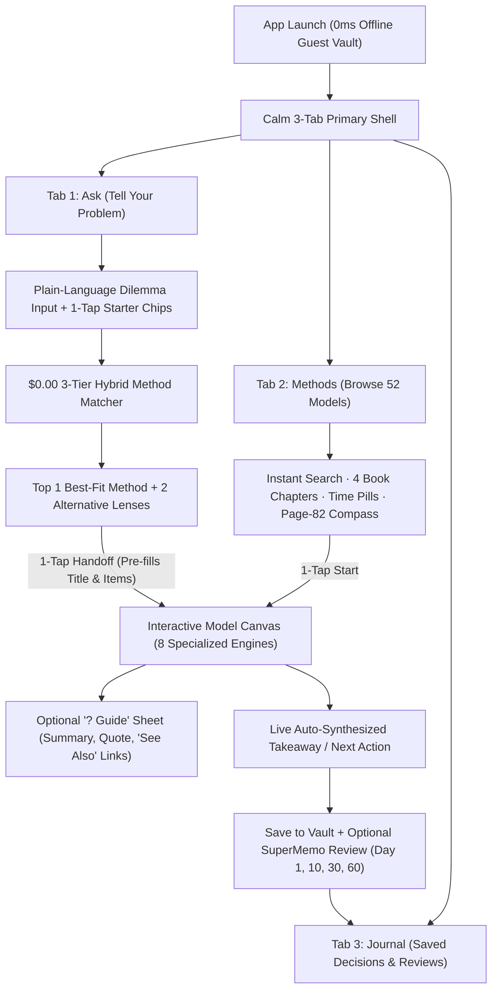
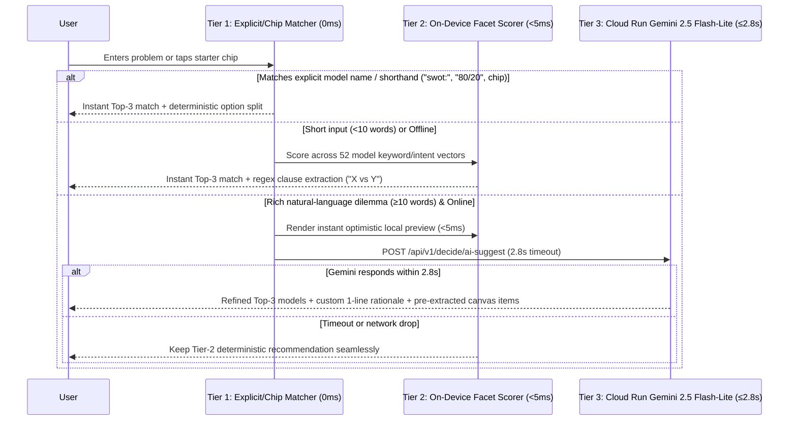

# Product Requirements Document (PRD): Decide50 — Strategic Decision Studio

**Source Material:** *The Decision Book: Fifty Models for Strategic Thinking* (Mikael Krogerus & Roman Tschäppeler)  
**Target Platforms:** Android (Play Store `.aab`/`.apk`), Responsive Web PWA, and Tablet/Desktop Split-View (`≥900 px`)  
**Design North Star:** *Zero-friction clarity — go from a messy thought to a structured visual decision in under 90 seconds.*

---

## 1. Product Vision & Core Value Proposition

Most people know great mental models exist—Eisenhower Matrix, SWOT, Rubber Band Dilemma, Pareto 80/20, Flow, Six Thinking Hats—but in the middle of real-life stress, two barriers stop them from using those frameworks:
1. **Selection Paralysis:** *"I have a messy problem, and I don't know which of the 50 models fits my situation."*
2. **Blank-Page Friction:** *"Reading a textbook chapter and drawing axes on paper takes too much effort when I just need an answer."*

**Decide50** turns *The Decision Book* from a static reading experience into an effortless, offline-first **interactive workbook** built around **two equal, first-class entry modes**:

1. **Mode 1 — "Tell Your Problem" (Guided Problem Concierge):** The user types (or taps) their dilemma in plain language. The app instantly recommends the **#1 best-fit model** (plus 2 alternative angles), explains *why* in one sentence, and pre-populates the chosen interactive canvas with their problem—**zero re-typing**.
2. **Mode 2 — "Use a Method Directly" (52-Model Interactive Library):** The user searches or browses all **52 chapters** from *The Decision Book*—via instant search, the book's 4 chapters, time-to-complete chips (`⚡ 1 min`), or the book's Page-82 **Me↔Others × Doing↔Thinking** Meta-Compass—and launches straight into a clean interactive canvas in **1 tap**.

> [!IMPORTANT]
> **Calm, Uncluttered Swiss Minimalism + Compact `?` Technique Popover:**
> 1. **Present Without Clutter:** Secondary controls (scope filters, sample prompts, library filters, reset/example actions, account/reminder/bug utilities) live inside quiet popovers, `⋯` menus, or collapsible rows rather than crowding the screen with rows of pills and badges.
> 2. **Writeups Hidden Under `?` (Never Full-Screen):** Every technique includes a concise plain-English writeup (*What it is & why it works* + *How to use it*), tucked cleanly behind a **`?` button** that opens a **compact floating card**—leaving the workspace and recommendation screens uncluttered and focused on immediate interaction.

---

## 2. Dual-Mode User Journey Architecture

---

## 3. Core UX Principles & `360×800` Ergonomics

To guarantee effortless access on compact phones (`360×800`) as well as tablets/desktops (`≥900 px`):

| UX Principle | Concrete Design Rule |
| :--- | :--- |
| **1. Compact `?` Technique Popover** | Primary screens and workspaces stay 100% focused on action—no multi-line prose inline. Tapping the **`?` button** on any card or workspace opens a **compact floating info card** (never full-screen) with a concise 3–4 sentence plain-English writeup, *How to use* tip, quote, and related models. |
| **2. Options Present, Never Crowded** | Keep primary surfaces spacious. Tuck scope filters (`Any / Personal / Team / Quick`), sample dilemmas, runner-up suggestions, library filters, and canvas tools (*Load Example, Reset, Related Models*) into subtle popovers, `⋯` menus, and collapsible drawers rather than stacking multiple rows of pills and badges. |
| **3. Zero-Retype Handoff** | When a user describes a problem in Mode 1, opening a recommended technique pre-fills the decision topic and seeds parsed options automatically. |
| **4. Clean `360×800` & Split-View Ergonomics** | Use clean typography, subtle hairline dividers, and minimal SVG line icons (zero emoji soup). On `360 px` screens, matrices use a clean segmented quadrant selector + compact visual 2×2 grid; on `≥900 px` screens, the workspace expands into a spacious two-pane layout. |
| **5. Live Plain-English Takeaway** | Every interactive workspace synthesizes a calm **Takeaway** block at the bottom translating the user's entries into a clear next step. |
| **6. Calm 3-Tab Shell + Accordion Settings** | Bottom navigation has only **Decide**, **Techniques**, and **Journal**. Account Sync, Reminders, Export, and Bug Reporting live in a single clean Profile sheet using one-at-a-time expandable rows. |

---

## 4. Mode 1 Specification: "Tell Your Problem" (`$0.00` Hybrid Concierge)

### 4.1 Interface Elements
- **Single Calm Prompt Card:** Multi-line `TextField` (*"What decision, dilemma, or team challenge is on your mind?"*) with clear button and 1-tap submit.
- **Instant Starter Chips (`Wrap`):** 6 common human scenarios for zero-typing exploration:
  - *⚖️ Stuck between two good options*
  - *🔥 Drowning in urgent tasks*
  - *💼 Unsure if I should change jobs*
  - *⚡ Need a fresh creative idea*
  - *🤝 Resolving a conflict*
  - *👥 Aligning or leading a team*
- **Optional 1-Tap Scope Filter:** `Auto-Detect` (default), `Just Me`, `Team / Others`, `⚡ Quick (<2 min)`.
- **Recommendation Stack:**
  1. **Primary Match Card (Highlighted):** Model badge, completion time (`1–4 min`), 1-sentence **"Why this fits"** tailored to the user's input, visual glyph of the framework, and full-width **"Use This Method →"** button.
  2. **2 Alternative Lenses:** Compact cards offering complementary angles (e.g., *Quick gut-check* vs. *Deep root-cause reflection*).

### 4.2 3-Tier `$0.00` Hybrid Recommendation & Pre-Fill Pipeline

---

## 5. Mode 2 Specification: Direct Method Library & Meta-Compass

Users who already know *The Decision Book* (or want to browse) get instant, structured access to all **52 chapters**:

1. **Instant Search Bar:** Matches model title (*"Eisenhower"*, *"Johari"*, *"Chasm"*), book subtitle (*"work more efficiently"*, *"deal with a dilemma"*), or problem keywords (*"trust"*, *"pricing"*, *"memory"*, *"delegation"*).
2. **Two Browsing Views (1-Tap Toggle):**
   - **Cards View:** Scannable cards grouped or filtered by the book's **4 Official Sections**:
     1. **Improve Yourself** *(Me + Doing — 13 models)*
     2. **Understand Yourself Better** *(Me + Thinking — 17 models)*
     3. **Understand Others Better** *(Others + Thinking — 15 models)*
     4. **Improve Others** *(Others + Doing — 7 models)*
   - **Book Meta-Compass View (Page 82 Map):** Interactive 4-quadrant visual map (`DOING ↔ THINKING` × `ME ↔ OTHERS`) where users tap any quadrant or plotted dot to preview and open a model.
3. **Quick-Access Filter Pills (`Wrap`):** `All (52)` · `★ Favorites` · `⚡ 1-Min Quick` · `⊞ 2×2 Matrices` · `⚖️ Dilemmas` · `👥 Team & Leadership` · `💡 Creativity`.

---

## 6. The 8 Interactive Canvas Engines (Covering All 52 Models)

Rather than forcing 52 wildly inconsistent UIs—or worse, reducing everything to generic text boxes—every chapter in *The Decision Book* is powered by one of **8 purpose-built, touch-ergonomic interactive engines**:

| Engine ID | Interactive UI Mechanic | Example Flagship Models |
| :--- | :--- | :--- |
| **E1. `quadrant_2x2`** | **Quick-Add + 4 One-Tap Quadrant Pills + Visual 2×2 Mini-Map.** Tap any item to move quadrants or mark actioned; auto-summarizes quadrant balance. | #01 Eisenhower, #02 SWOT, #03 BCG, #07 Feedback, #15 Johari, #36 AI Discussion |
| **E2. `force_balance`** | **Dual-Side Weighted Tug-of-War.** Add factors with weight `1–5` on opposing sides (*Holding* vs *Pulling*, *Belief* vs *Behavior*, *Vital 20%* vs *80%*); live tension bar. | #06 Rubber Band, #16 Cognitive Dissonance, #38 Pareto 80/20, #45 Prisoner's Dilemma |
| **E3. `radar_sliders`** | **Thumb Sliders + Live Morphing SVG Polygon / Sail / Channel / Pie.** Zero typing required if desired—drag sliders (`0–10` or `%`) and see live diagnostic zones. | #14 Flow Channel, #19 Uffe Elbæk Radar, #21 Energy Pie, #24 Performance Sail, #47 Team Skills, #48 Market Gap |
| **E4. `checklist_stepper`** | **Interactive Criteria Toggles & Diagnostic Stage Steppers.** Tap yes/no criteria or symptom chips to pinpoint your exact stage or readiness score. | #05 Whitmore Goals (SMART/PURE/CLEAR + KISS), #12 Conflict Ladder, #31 Swiss Cheese, #32 Maslow, #46 Drexler–Sibbet, #49 Hersey–Blanchard |
| **E5. `idea_combinator`** | **Tap-to-Connect Parameter Grid & Perspective Switcher.** Combine 1 trait per row into a novel concept, flip SCAMPER cards, draw on the 9-dot grid, or cycle De Bono's 6 Hats. | #09 Morphological Box + SCAMPER, #33 Outside the Box, #50 Role-Playing (6 Hats & Belbin) |
| **E6. `timeline_curve`** | **Structured Past/Future Lanes, Promptness Curves & 3-Loop Timers.** Guided milestone chips, gift curve calculator, 6-road signpost selector, and 3-loop deadline splitter. | #10 Esquire Gift, #11 Consequences, #13 Crossroads, #22 SuperMemo, #25 Making-Of, #35 Double-Loop, #51 Result Optimisation |
| **E7. `network_mapper`** | **Concentric Relationship Rings, Referral Trees & Risk Audits.** Place contacts/ideas by frequency/group or trace referral chains to spot single-point concentration risks. | #08 Family Tree, #29 Network Target, #37 Small-World, #39 Long-Tail, #41 Black Swan |
| **E8. `sim_custom`** | **Live Monte Carlo Dot-Rain / Range Simulator + Custom Model Builder.** Enter min/likely/max ranges to run 1,000 instant trials, or build your own 2×2 / slider model (*My Models*). | #40 Monte Carlo Simulation, #52 World's Next Top Model + *My Models* Studio |

---

## 7. Complete 52-Model Specification Matrix (From PDF)

Every single model from *The Decision Book* PDF is included below with its exact section, book subtitle, assigned interactive engine, and automated takeaway output:

### Part I: How to Improve Yourself *(Me · Doing — 13 Models)*
| # | Model Name | Book Subtitle | Engine | Interactive Inputs & Automated Verdict |
| :- | :--- | :--- | :--- | :--- |
| 01 | **The Eisenhower Matrix** | How to work more efficiently | `E1` | Sort tasks into *Do Immediately*, *Schedule When*, *Delegate*, *Do Later* → Highlights top #1 focus task (Buffett rule) & warns if strategic quadrant is empty. |
| 02 | **The SWOT Analysis** | How to find the right solution | `E1` | Add *Strengths, Weaknesses, Opportunities, Threats* → Generates S→O leverage & W→T defence prompts. |
| 03 | **The BCG Box** | How to evaluate costs and benefits | `E1` | Classify projects/investments into *Stars, Cash Cows, Question Marks, Dogs* → Portfolio balance verdict (*Invest, Milk, Decide, Liquidate*). |
| 04 | **Project Portfolio Matrix** | How to maintain an overview | `E1` | Customizable axes (*On-Time vs Budget* OR *Vision Alignment vs Learning*) → Flags projects to *Reject, Delegate, Reshape,* or *Jackpot*. |
| 05 | **The John Whitmore Model** | Am I pursuing the right goal? | `E4` | Separate *Final Goal* + *Daily Performance Goal*; toggle **KISS (5 checks)** or **Full 14 (SMART + PURE + CLEAR)** → Goal strength score & weak-link fix. |
| 06 | **The Rubber Band Model** | How to deal with a dilemma | `E2` | Weighted factors for *"What is holding me?"* vs *"What is pulling me?"* → Live rubber-band tension visual & net pull direction. |
| 07 | **The Feedback Model** | Dealing with compliments and criticisms | `E1` | Sort feedback into *Compliment (Keep)*, *Advice (Good, still change)*, *Suggestion (Ignore/Live with)*, *Criticism (Must change)* + Luck check → Clear action list. |
| 08 | **The Family Tree Model** | The contacts you should maintain | `E7` | Map clients/friends by *"Who introduced whom?"* + *Promoter / Passive / Critic* tag → Calculates Promoter Ratio & flags over-concentrated branches. |
| 09 | **Morphological Box & SCAMPER** | Why you have to be structured to be creative | `E5` | Define parameters × attributes and tap 1 per row to connect a configuration line + interactive 7-step *SCAMPER* idea prompts. |
| 10 | **The Esquire Gift Model** | How much to spend on gifts | `E6` | Select *Relationship* (Partner, Child, Friend, Boss, Service) + *Years Known* + *Milestone* → Plots on Esquire curve & suggests generous gift range. |
| 11 | **The Consequences Model** | Why it is important to make decisions promptly | `E6` | Sliders for *Current Knowledge %* vs *Decision Impact %* → Shows position on Kreiner–Christensen crossover curve & prompts *Decide Boldly Now* vs *Explicitly Communicate Delay Date*. |
| 12 | **The Conflict Resolution Model** | How to resolve a conflict elegantly | `E4` | Interactive 6-step reaction mapper (*Escape, Fight, Give Up, Evade, Compromise, Consensus*) for You vs Counterpart → Guided *"Third-Way Consensus"* builder. |
| 13 | **The Crossroads Model** | So what next? | `E6` | 5 quick context chips (*Origin, Core Values, Key People, Blockers, Fears*) → Compare & score the **6 Future Roads** (*Beckoning, Wildest Dream, Sensible, Untravelled, Familiar, Safe Return*). |

### Part II: How to Understand Yourself Better *(Me · Thinking — 17 Models)*
| # | Model Name | Book Subtitle | Engine | Interactive Inputs & Automated Verdict |
| :- | :--- | :--- | :--- | :--- |
| 14 | **The Flow Model** | What makes you happy? | `E3` | Rate recent activities on *Challenge (1–10)* × *Ability (1–10)* + 5 Flow criteria toggles → Plots on *Burnout / Flow / Boreout / Apathy* chart with adjustment tip. |
| 15 | **The Johari Window** | What others know about you | `E1` | Pick self-adjectives vs peer-perceived adjectives → Auto-populates *Arena, Hidden Façade, Blind Spot,* and *Unknown* panes (+ copyable peer link/prompt). |
| 16 | **Cognitive Dissonance Model** | Why people smoke when they know it's unhealthy | `E2` | Enter *My Attitude/Belief* vs *My Actual Action* → Exposes self-justification & guides a concrete choice: *Change Action* OR *Consciously Revise Attitude*. |
| 17 | **The Music Matrix** | What your taste in music says about you | `E1` | Place favorite artists/cultural tastes across *Mainstream↔Avantgarde* × *Authentic↔Designed* → Reveals cultural taste profile. |
| 18 | **The Unimaginable Model** | What do you believe in that you cannot prove? | `E1` | Map core beliefs across *Provable↔Not Provable* × *Imaginable↔Unimaginable* → Distinguishes evidence-backed facts from mental models taken on faith. |
| 19 | **The Uffe Elbæk Model** | How to get to know yourself | `E3` | 4 constant-sum (`=10`) sliders: *Global↔Local, Team↔Individual, Brain↔Body, Content↔Form* for **Current Self** vs **Ideal Self** → Overlaid radar gap analysis. |
| 20 | **The Fashion Model** | How we dress | `E1` | Dual mode: *Past↔Future × Appearance↔Reality* OR *Casual↔Formal × Old School↔Hip* (with Neutral Zone) → Style & signaling snapshot. |
| 21 | **The Energy Model** | Are you living in the here and now? | `E3` | 3 linked sliders summing to `100%`: *Past %*, *Now %*, *Future %* → Live 3D-style pie classifying *Memory-Driven*, *Reality-Driven*, or *Dream-Driven*. |
| 22 | **The SuperMemo Model** | How to remember everything you have ever learned | `E6` | Capture a key insight/skill to retain → Visualizes forgetting curve & schedules 1-tap native review reminders at **Day 1, Day 10, Day 30, and Day 60**. |
| 23 | **The Political Compass** | What political parties stand for | `E1` | Quick stance sliders or direct pin on *Economic Left↔Right* × *Liberalism↔Authoritarianism* (with optional *"10 years ago"* comparison pin). |
| 24 | **Personal Performance Model** | Recognise whether you should change your job | `E3` | Rate today `1–10` on **Have To**, **Able To**, **Want To** → Draws triangular "Sail" & overlays multi-day history to diagnose variety vs stagnation. |
| 25 | **The Making-Of Model** | To determine your future, understand your past | `E6` | Pick a past timeframe → Fill 5 concise lanes (*People, Initial Goals, Obstacles Overcome, Successes, Lessons*) → Distills *"Bridge to the Future"*. |
| 26 | **The Personal Potential Trap** | Why it is better not to expect anything | `E3` | Score *My Expectations*, *Others' Expectations*, and *Actual Achievements* across career stages → Calculates Trap Risk & generates *"Promise 80, Deliver 120"* plan. |
| 27 | **The Hype Cycle** | How to identify the next big thing | `E4` | Diagnose an idea, tech, or relationship across Gartner's 5 phases (*Trigger, Peak, Trough, Slope, Plateau*) → Timing & action recommendation. |
| 28 | **The Subtle Signals Model** | Why nuances matter | `E1` | Map key people/channels by *Contact Frequency* × *Actual Effect* → Highlights high-impact allies to nurture & noisy low-effect habits to trim. |
| 29 | **The Network Target Model** | What your friends say about you | `E7` | Place inner circle on *Friends / Family / Colleagues / Acquaintances* × *Daily / Weekly / Monthly / Yearly* bullseye + demographic balance sliders. |
| 30 | **Superficial Knowledge Model** | Everything you don't need to know | `E1` | Playful self-audit sorting knowledge/talking points across *Easy↔Difficult* × *Embarrassing↔Impressive*. |

### Part III: How to Understand Others Better *(Others · Thinking — 15 Models)*
| # | Model Name | Book Subtitle | Engine | Interactive Inputs & Automated Verdict |
| :- | :--- | :--- | :--- | :--- |
| 31 | **The Swiss Cheese Model** | How mistakes happen | `E4` | Audit defences across *Active Mistakes, Black-Outs, Slip-Ups* & *People / Tech / Org / External* slices → Highlights aligned holes & single highest-leverage safeguard. |
| 32 | **The Maslow Pyramids** | What you actually need, what you actually want | `E4` | Score *"Satisfied Today"* vs *"Chasing Most"* across *Physiological, Security, Social, Recognition, Self-Actualisation* → Visualizes dual inverted pyramids & need/want mismatch. |
| 33 | **Thinking Outside the Box** | How to come up with brilliant ideas | `E5` | Interactive **9-Dot 4-Line Touch Puzzle** + **Unstated Rule Breaker** (*"List 3 rules you're assuming exist → break 1"*). |
| 34 | **Sinus Milieu & Bourdieu** | Where you belong | `E1` | Position target audience (or self/parents) on *Social Status × Orientation (Tradition / Modernisation / Reorientation)* or *Economic × Cultural Capital*. |
| 35 | **Double-Loop Learning** | How to learn from your mistakes | `E6` | Map a recurring mistake: *Action → Result → Single-Loop Fix* vs **Double-Loop Reframe** (*Espoused Theory vs Theory-in-Use underlying belief*). |
| 36 | **The AI Model** | What kind of discussion type are you? | `E1` | Log meeting dynamics across *No! (Dictator)*, *No, because... (Schoolteacher)*, *Yes, but... (Fault-Finder)*, and *Yes, and... (AI Thinker)* + reframe prompt. |
| 37 | **The Small-World Model** | How small the world really is | `E7` | Build a ≤6-step warm-introduction bridge from *You* → *Connector* → *Target Person/Audience*. |
| 38 | **The Pareto Principle** | 80% of output from 20% of input | `E2` | List tasks/clients/efforts and score impact → Automatically highlights the **Vital 20%** top levers to prioritize today. |
| 39 | **The Long-Tail Model** | How the internet transforms the economy | `E7` | Evaluate product/content strategy between *Head 20% Mass Blockbusters* vs *Tail 80% Underserved Niches*. |
| 40 | **Monte Carlo Simulation** | Why we can only approximate an outcome | `E8` | Input *Min / Likely / Max* estimates (e.g., cost, timeline, revenue) → Runs 1,000 live trials + interactive dot-rain visual showing P10 / P50 / P90 confidence bands. |
| 41 | **The Black Swan Model** | Why experiences don't make you wiser | `E7` | Uncover "Turkey Illusions": list assumptions based solely on past calm + stress-test against 3 unexpected shock scenarios (*Fragile → Robust*). |
| 42 | **The Chasm (Diffusion Model)** | Why everybody has an iPod | `E4` | Pinpoint product adoption stage (*Innovators, Early Adopters, THE CHASM, Early Majority, Late Majority, Sceptics*) → Specific chasm-crossing playbook. |
| 43 | **The Black Box Model** | Why faith is replacing knowledge | `E4` | Score system *Complexity × Speed* → Distinguishes explainable systems from Black Boxes and defines input/output verification checks. |
| 44 | **The Status Model** | How to recognise a winner | `E1` | Map social/brand positioning on *Earned↔Inherited* × *Altruistic↔Egoistic* (*Sustainable Luxury, Nouveau Riche, Old Money, Heirs*). |
| 45 | **The Prisoner's Dilemma** | When is it worth trusting someone? | `E2` | Customize payoff stakes for *Mutual Trust vs Betrayal* + simulate single-shot vs repeated **Axelrod Tit-for-Tat** cooperation strategy. |

### Part IV: How to Improve Others *(Others · Doing — 7 Models + Custom Studio)*
| # | Model Name | Book Subtitle | Engine | Interactive Inputs & Automated Verdict |
| :- | :--- | :--- | :--- | :--- |
| 46 | **Drexler–Sibbet Team Model** | How to turn a group into a team | `E4` | Tap current team mood adjectives → Locates team on the **7-Stage V-Curve** (*Orientation → Renewal*) & lists exact unresolved items to clear next. |
| 47 | **The Team Model** | Is your team up to the job? | `E3` | Define 4–6 required hard/soft skills + *Critical Boundary (0–10)*; score members → Multi-line skill chart exposing coverage gaps & single points of failure. |
| 48 | **Gap-in-the-Market Model** | How to recognise a bankable idea | `E3` | Plot competitors + your idea on *Cost-Effectiveness × Prestige × Awareness (bubble size)* → Highlights uncrowded niche vs crowded red ocean (+ demand warning). |
| 49 | **Hersey–Blanchard Model** | How to successfully manage employees | `E4` | Select person's *Task Expertise* & *Morale/Commitment* → Prescribes exact leadership mode: **S1 Instruct**, **S2 Coach**, **S3 Support**, or **S4 Delegate**. |
| 50 | **Role-Playing (6 Hats & Belbin)** | How to change your own point of view | `E5` | Interactive **De Bono 6 Thinking Hats** stepper (*White, Red, Black, Yellow, Green, Blue*) to capture 1 thought per hat + **Belbin 9 Roles** team balance check. |
| 51 | **Result Optimisation Model** | Why the printer breaks before a deadline | `E6` | Enter total time/deadline → Auto-divides into **3 Equal G→C→I Loops** (*Loop 1 Draft Plan, Loop 2 Refinement, Loop 3 Optimisation*) with milestone timestamps. |
| 52 | **World's Next Top Model & My Models** | What can we learn + *Now It's Your Turn* | `E8` | Meta-reflection checklist (*"What is this model hiding?"*) + **Custom Model Studio** where users create & save their own reusable 2×2, Slider, or Step model! |

---

## 8. Technical Architecture, Offline Vault & Native Capabilities

### 8.1 Monorepo Structure
- `decide50_app/` — Flutter cross-platform client (Android, Web PWA, Tablet/Desktop responsive split-view at `≥900 px`).
- `decide50_backend/` — Stateless Node.js + Express API (`server.js`), PostgreSQL `schema.sql` (with zero-DB in-memory fallback), `Dockerfile`, `deploy_cloudshell.sh`, `triage_bugs.js`.
- `docs/` — Synchronized product, design, backend, deployment, publishing, and privacy specs + `docs/mocks/interactive_mocks.html`.
- `store_assets/` — Play Store listing copy, generated brand icons (`512`, `1024`), feature graphic (`1024×500`), and phone/tablet screenshots.

### 8.2 Offline-First Vault & Account Isolation
- **Day-1 Offline Guest Mode:** App boots straight into `local_guest_vault` (`SharedPreferences` JSON snapshot) in `<50 ms`. Pre-seeds 1 starter Rubber Band dilemma guarded by `defaultSeeded: true`.
- **Account Isolation & Zero-Loss Upgrade:** Keys namespaced as `decide50_vault_v2_<userId>`. Upgrading from Guest to **Email/Password (`scrypt`)** or **Google Sign-In** (GIS on Web; Cloud Run external-browser session handoff on Android) merges guest decisions cleanly without data loss; sign-out clears in-memory state immediately.
- **Real-Calendar Resilience:** SuperMemo spaced decision reviews (`+1d`, `+10d`, `+30d`, `+60d`) group overdue reviews into a calm 1-tap **"Catch Up"** banner rather than stranding users in stale past dates.

### 8.3 Lightweight Native Bridges (`MethodChannel`) & Closed-Loop Bug Triage
- **Native Android Reminders (`com.decide50.app/native`):** Uses Kotlin `AlarmManager.setAndAllowWhileIdle` + `BroadcastReceiver` (`BOOT_COMPLETED` / `MY_PACKAGE_REPLACED`) + Android 13+ `POST_NOTIFICATIONS` permission—no `SCHEDULE_EXACT_ALARM` or bloated notification SDKs.
- **Native File Export:** `.md` (human-readable strategic brief) and `.json` (full vault backup) via Android Storage Access Framework (`ACTION_CREATE_DOCUMENT`) with Share-sheet fallback and browser download on Web.
- **Closed-Loop In-App Bug Triage:** `BugReportDialog` in the Profile sheet captures `pageContext`, `appVersion`, and `userEmail`, saves locally first, syncs to `/api/v1/bugs`, displays only the current user's open reports, and auto-prunes resolved tickets.

---

## 9. Core User Journeys (CUJs) & Release Verification Gate

Every release must pass automated widget verification at a strict **`360×800` mobile viewport** (`0` render overflows) plus `≥900 px` tablet layout checks:

1. **CUJ 1 — Instant Guest Launch & Mode 1 Problem-to-Decision Flow:** Launch cold without login → type dilemma in *Ask* tab → tap recommended model → verify problem title & items pre-populate → add/adjust inputs → read live verdict → save to Journal.
2. **CUJ 2 — Mode 2 Direct Method Browse & Meta-Compass:** Search `"Eisenhower"` or filter by *Improve Others* / *Page-82 Compass* → launch any of the 8 canvas engines → open `? Guide` sheet → follow a `See also` link to a related model.
3. **CUJ 3 — Multi-User Isolation & Guest Upgrade:** Create decisions as Guest → register User A (verify guest data migrated) → sign out → register User B (verify clean isolated vault, zero leak from User A).
4. **CUJ 4 — SuperMemo Spaced Review, Native Reminders & Export:** Save decision with SuperMemo review enabled → verify `MethodChannel` reminder configuration → simulate multi-day return catch-up → export `.md` decision brief.
5. **CUJ 5 — Offline-Safe Bug Reporting & Reconciliation:** Submit bug from Profile sheet → verify `pageContext` attached & visible under *Open Reports* → mark resolved on server → verify pruned locally.

---

## 10. Phased Implementation Plan (Ready on Approval)

1. **Phase 1 — Interactive Mocks & Spec Sign-Off *(Current Step)*:** Review PRD + full interactive HTML prototype covering Mode 1, Mode 2, all 52 models across the 8 interactive engines, Journal, and Profile/Settings sheet.
2. **Phase 2 — Flutter App Foundation, 52-Model Catalog & Offline Vault:** Scaffold `decide50_app` with warm Swiss/Chalkboard light & dark themes, `AuthService`, `VaultStorage`, and full 52-model schema.
3. **Phase 3 — All 8 Interactive Canvas Engines & `$0.00` Hybrid Concierge:** Implement the 8 tactile canvas widgets, live verdict synthesizers, deterministic on-device matcher, and `decide50_backend` Cloud Run API + `gemini-2.5-flash-lite` proxy.
4. **Phase 4 — Native Android Reminders, SAF Export & Bug Triage:** Wire Kotlin `MethodChannel` bridges and `BugReportDialog` + `triage_bugs.js`.
5. **Phase 5 — `360×800` CUJ Test Suite, Signed `.aab`/`.apk` & Play Store Kit:** Pass `flutter analyze` (`0` issues) + `flutter test` (`100%` passing), build release artifacts, and generate Play Store icons & screenshots.
